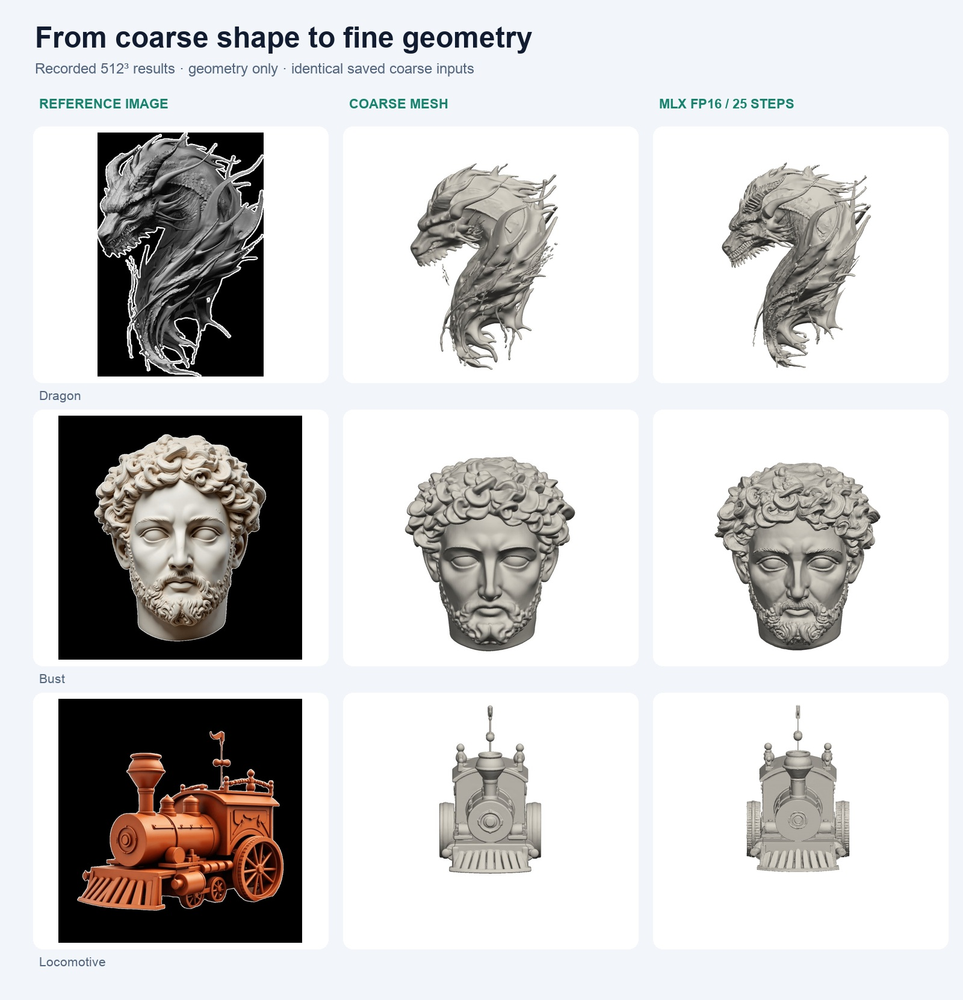
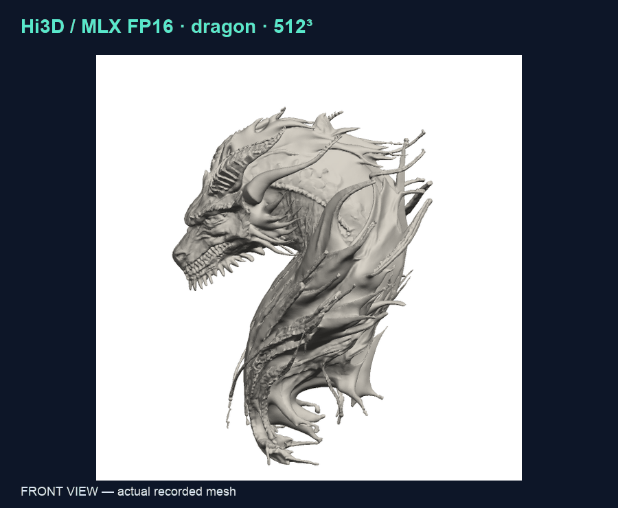
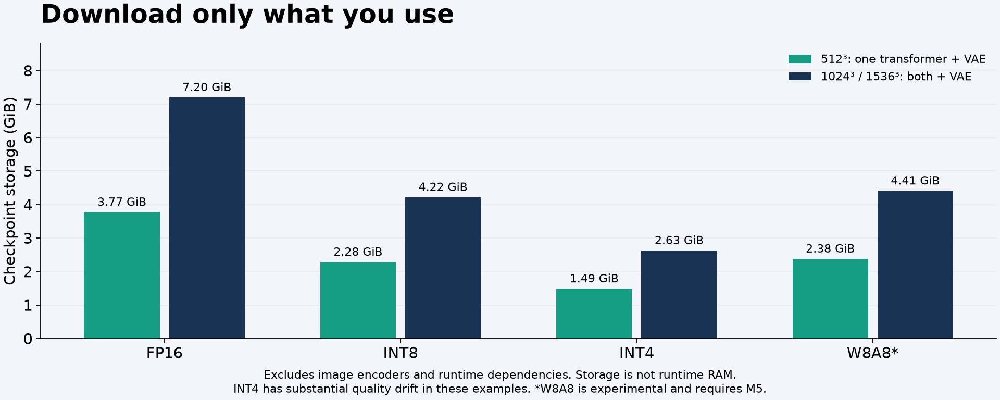
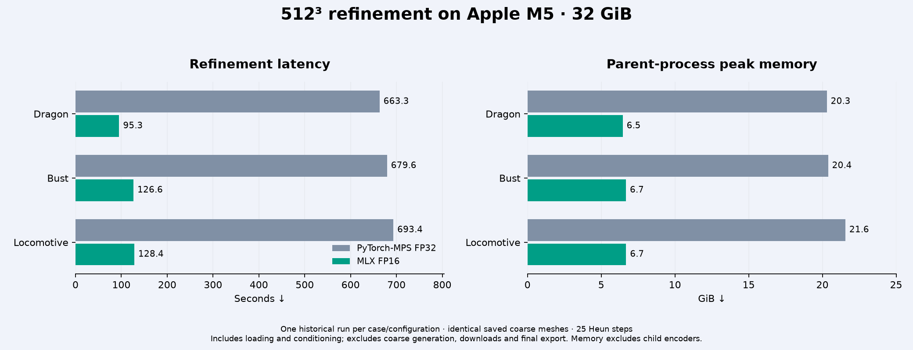

<p align="center">
  
</p>

<p align="center">
  <a href="https://github.com/devin-lai/Hi3Dv1.0-mlx/actions/workflows/ci.yml"></a>
  <a href="https://huggingface.co/devin-lai/Hi3Dv1.0-mlx"></a>
  <a href="USAGE.md#hardware"></a>
  <a href="LICENSE"></a>
</p>

<h1 align="center">Hi3D v1.0 for Apple silicon</h1>
<p align="center"><strong>Turn a reference image and a coarse mesh into detailed 3D geometry — locally with MLX.</strong></p>
<p align="center">
  <a href="#quick-start">Quick start</a> ·
  <a href="#choose-your-model">Choose a model</a> ·
  <a href="https://huggingface.co/collections/devin-lai/hi3d-v10-3d-refinement-on-apple-silicon-6adf317e5c1d7d1672cd06f7">Collection</a> ·
  <a href="#measured-performance">Benchmarks</a> ·
  <a href="https://huggingface.co/datasets/devin-lai/Hi3Dv1.0-mlx-results">Meshes & galleries</a> ·
  <a href="README.zh-CN.md">简体中文</a>
</p>

**Local inference. Ready-to-use weights. Selective downloads.** This community MLX port of [Hi3D v1.0](https://huggingface.co/hi3d-official/Hi3Dv1.0) includes FP16, INT8, INT4 and experimental W8A8 variants. This GitHub repository contains the inference runtime, tests, a runnable example and benchmark evidence. Model weights and the optional results dataset live on Hugging Face. Checkpoint conversion tooling remains private.

| Refine locally | Pick your footprint | Inspect the evidence |
|---|---|---|
| 512³, 1024³ and 1536³ sparse extraction grids | Download one precision and only the required transformers | 87 historical runs, 68 unique meshes, three example objects |

The model refines **geometry**, using **both an image and an existing coarse mesh**. It does not generate textures or create the initial coarse mesh. Colorful renders below show surface normals. Validated on the M5 family; see [hardware notes](USAGE.md#hardware).

## See the geometry



Download one recorded output: [Dragon GLB · 17.2 MiB](https://huggingface.co/datasets/devin-lai/Hi3Dv1.0-mlx-results/resolve/v1.0.0/datasets/meshes/1c125d48befd028ea433665944d5b16b4e40904836ec97736d95f50e8d5d7bb1.glb?download=true) · [Bust GLB · 17.2 MiB](https://huggingface.co/datasets/devin-lai/Hi3Dv1.0-mlx-results/resolve/v1.0.0/datasets/meshes/6870434d8f9916edb4d2635b85758f3d3590896aafb7692c7f872e9bac5bda1a.glb?download=true) · [Locomotive GLB · 17.2 MiB](https://huggingface.co/datasets/devin-lai/Hi3Dv1.0-mlx-results/resolve/v1.0.0/datasets/meshes/7324268d80a9b6c4f16a9a643a889f7b9b8ddcead8ddfa69ae41f991ec4158cb.glb?download=true).

<details>
<summary><strong>Two views of the same recorded mesh</strong></summary>



These images are rendered from saved benchmark outputs. No generated promotional imagery is presented as model output. Original inputs and derived assets retain their [documented third-party terms](https://huggingface.co/datasets/devin-lai/Hi3Dv1.0-mlx-results/blob/main/datasets/README.md).

</details>

## Quick start

Use **Apple silicon, native arm64 Python 3.12 and macOS with Metal support**. The recorded stack is macOS 27.0.1 and MLX 0.32.4. [Install uv](https://docs.astral.sh/uv/getting-started/installation/), then:

```bash
git clone https://github.com/devin-lai/Hi3Dv1.0-mlx.git
cd Hi3Dv1.0-mlx
uv venv --python 3.12 .venv
source .venv/bin/activate
uv pip install .

hi3d-mlx refine \
  --image examples/dragon.png \
  --coarse-mesh examples/dragon_coarse.glb \
  --preset fp16 --resolution 512 --output dragon-refined.glb
```

The first run fetches the shared VAE/configs, the **512 transformer only**, and two pinned image encoders. Later runs reuse the cache. The output includes a GLB mesh and a JSON timing/memory record. Replace the two example inputs with your own image and coarse mesh to refine another object.

For smaller weights, use `--preset int8`. For higher resolution, use `--resolution 1024` or `1536`; the high-resolution transformer downloads when needed. [Python API, offline use and troubleshooting →](USAGE.md)

## Choose your model

| Repository | 512³ download¹ | 1024³ / 1536³ download¹ | Best fit |
|---|---:|---:|---|
| [FP16](https://huggingface.co/devin-lai/Hi3Dv1.0-mlx-fp16) | **3.77 GiB** | 7.20 GiB | **Start here.** Reference MLX configuration. |
| [INT8](https://huggingface.co/devin-lai/Hi3Dv1.0-mlx-int8) | **2.28 GiB** | 4.22 GiB | Smaller storage and good observed reference agreement. |
| [INT4](https://huggingface.co/devin-lai/Hi3Dv1.0-mlx-int4) | **1.49 GiB** | 2.63 GiB | Storage first; substantial quality drift in the tested cases. |
| [W8A8](https://huggingface.co/devin-lai/Hi3Dv1.0-mlx-w8a8) | **2.38 GiB** | 4.41 GiB | Experimental native INT8 compute on M5. |

¹ Transformer(s) plus the shared VAE; excludes image encoders, Python dependencies and runtime overhead. **Download size is not peak RAM.** The VAE is reused across variants. FP16 checkpoints contain FP16 and FP32 tensors; affine INT8/INT4 are weight quantization formats with FP16 computation.



[Shared VAE & configs](https://huggingface.co/devin-lai/Hi3Dv1.0-mlx-shared) · [Optional results dataset](https://huggingface.co/datasets/devin-lai/Hi3Dv1.0-mlx-results) · [Full preset guide](MODEL_INDEX.md)

`lean`, decoder-precision and reduced-step presets reuse existing checkpoints. They are runtime choices, not additional model downloads. `turbo` and `minimal` trade geometric agreement for speed; inspect the comparisons before using them for detailed work. Generic `mlx-lm` loaders do not implement this pipeline.

## Measured performance

In the original three-case **512³ / 25-step** cohort, MLX FP16 ran **5.37–6.96× faster than the local PyTorch-MPS FP32 reference**. This compares different precision configurations on the same recorded M5 / 32 GiB machine; it is not an NVIDIA comparison or a universal speed guarantee.



| Case | PyTorch-MPS FP32 | MLX FP16 | Speedup | FP16 parent peak² | Surface F-score @ 0.002³ |
|---|---:|---:|---:|---:|---:|
| Dragon | 663.3 s | **95.3 s** | 6.96× | 6.46 GiB | 0.9994 |
| Bust | 679.6 s | **126.6 s** | 5.37× | 6.68 GiB | 0.9996 |
| Locomotive | 693.4 s | **128.4 s** | 5.40× | 6.69 GiB | 0.9877 |

One historical run per case/configuration. Times include model loading, image conditioning, refinement and postprocessing, and exclude downloads, initial coarse generation and final file export. ² Parent-process physical footprint excludes child encoder processes and is not a whole-system memory requirement. ³ Agreement with the local FP32 reference after normalization, not a ground-truth reconstruction score. See [methodology, quality tradeoffs and fresh validation](BENCHMARKS.md).

## Explore, reproduce, contribute

- **Use the weights:** the CLI downloads only the files needed for your preset and resolution and verifies their SHA-256 hashes.
- **Inspect results:** download the [optional results dataset](https://huggingface.co/datasets/devin-lai/Hi3Dv1.0-mlx-results) for local wipe/flip comparison galleries and GLB files.
- **Report a result or issue:** use [GitHub issues](https://github.com/devin-lai/Hi3Dv1.0-mlx/issues/new/choose). Include chip, memory, macOS, preset, resolution and the generated metrics file.
- **Help others find it:** star this repository if it is useful, share a mesh comparison through the issue templates, or contribute a reproducible hardware report. [Contribution guide](CONTRIBUTING.md).

Inference source is in `src/`, with regression and numerical tests in `tests/`. [Release validation and fixes](VALIDATION.md) · [Machine-readable catalog](models/index.json) · [Repository map](repositories.json).

## What is in this repository?

| Path | Contents |
|---|---|
| [`src/hi3d_mlx`](src/hi3d_mlx) | Public CLI, Python API and verified selective downloads |
| [`src/hi3d_mac`](src/hi3d_mac) | MLX/Metal inference and macOS runtime adapters |
| [`src/sparc3d`](src/sparc3d) | Attributed upstream inference modules |
| [`examples`](examples) | Dragon image and coarse mesh for the quick start |
| [`tests`](tests) | Numerical, request-isolation and download regression tests |
| [`benchmarks`](benchmarks) | Exact historical data used in the charts and tables |
| [`scripts`](scripts) | Release checks and benchmark chart reproduction |

[47 tests and four-format smoke validation](VALIDATION.md) · [Contributing](CONTRIBUTING.md) · [Changelog](CHANGELOG.md). GitHub Actions verifies packaging and hardware-independent download behavior. Metal numerical tests run locally on supported hardware; the CI badge does not claim GPU performance validation.

## Attribution and license

Community MLX adaptation by **Devin Lai**, based on Hi3D v1.0 and the Sparc3D architecture. This is not an official upstream release or endorsement. [Powered by Hi3D 1.0](http://hi3d.ai/).

The **[Hi3D Open License Agreement v1.0](LICENSE)** and all retained third-party terms apply. It includes use, attribution, branding and scale conditions; this release does not replace them with MIT or Apache terms. See [NOTICE](NOTICE), [THIRD_PARTY_LICENSES.md](THIRD_PARTY_LICENSES.md) and [modifications](MODIFICATIONS.md). DINOv2, CLIP and saved Hunyuan-derived example assets retain their separate terms. Inference code and optimized weights are public; the converter and conversion research remain private.
