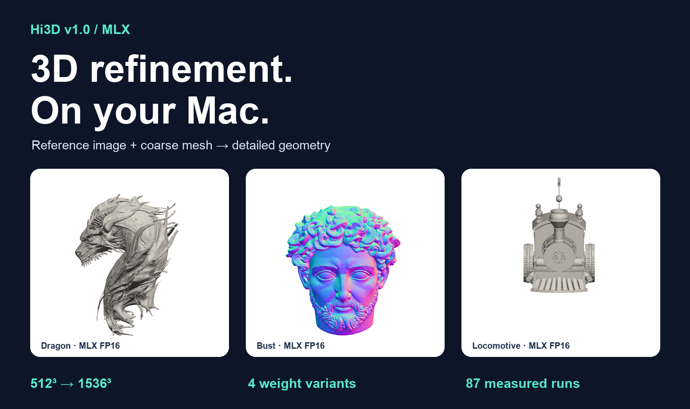

# Hi3D v1.0 · Apple 芯片 MLX 推理

[English](README.md) · [Hugging Face 模型](https://huggingface.co/devin-lai/Hi3Dv1.0-mlx) · [模型选择](MODEL_INDEX.md) · [完整使用说明](USAGE.md)



在 Mac 上用**参考图片和已有粗网格**细化 3D 几何。公开推理代码与预转换权重；转换工具保持私有。本项目是社区 MLX 适配，不代表上游官方背书。

## 快速开始

使用 Apple 芯片、原生 arm64 Python 3.12 和支持 Metal 的 macOS。历史测试为 M5 / 32 GiB，发布验证为 M5 Pro / 64 GiB。其他机型性能尚未充分验证。

```bash
git clone https://github.com/devin-lai/Hi3Dv1.0-mlx.git
cd Hi3Dv1.0-mlx
uv venv --python 3.12 .venv
source .venv/bin/activate
uv pip install .
hi3d-mlx refine --image examples/dragon.png \
  --coarse-mesh examples/dragon_coarse.glb \
  --preset fp16 --resolution 512 --output dragon-refined.glb
```

程序按需下载所选精度与分辨率需要的权重，并校验 SHA-256。512³ 只下载一个 Transformer；1024³ 和 1536³ 共用两个 Transformer。VAE 和配置单独共享，结果数据集可选下载。首次推理还需下载固定版本的 DINOv2 和 CLIP 图像编码器。

- **FP16**：推荐起点，几何质量参考配置。
- **INT8**：更小的权重，在已有测试中与参考结果较接近；不保证比 FP16 更快。
- **INT4**：更省存储，但已有案例存在明显几何偏差。
- **W8A8**：实验性整数计算路径，仅支持已验证的 M5 系列。

输出仅包含几何，不生成纹理，也不生成初始粗网格。下载大小不等于运行内存需求。历史 512³ 三案例中，FP16 相对本地 PyTorch-MPS FP32 参考快 5.37–6.96 倍；这不是与 NVIDIA 的对比，也不是通用性能承诺。[完整测试口径](BENCHMARKS.md)。

适用 [Hi3D Open License Agreement v1.0](LICENSE) 及保留的第三方条款；并未改为 MIT 或 Apache 授权。使用中请保留归属、使用限制及适用品牌展示要求。[Powered by Hi3D 1.0](http://hi3d.ai/)。

## 参与项目

如果项目对你有帮助，欢迎 Star、分享实际网格对比，或提交可复现的硬件测试报告。[贡献指南](CONTRIBUTING.md) · [问题与结果反馈](https://github.com/devin-lai/Hi3Dv1.0-mlx/issues/new/choose)。GitHub 仅包含推理代码、示例及测试数据，模型权重按需从 Hugging Face 获取；转换代码不在本仓库中。
